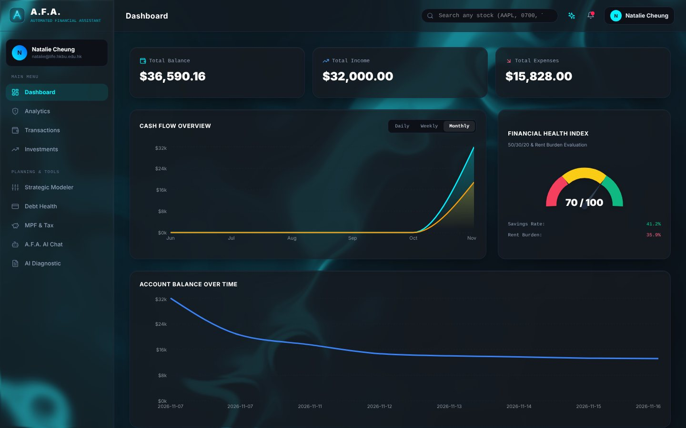
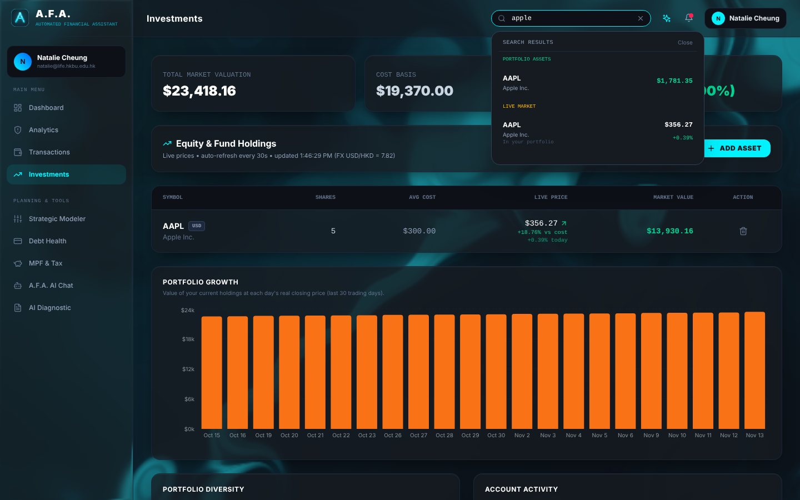
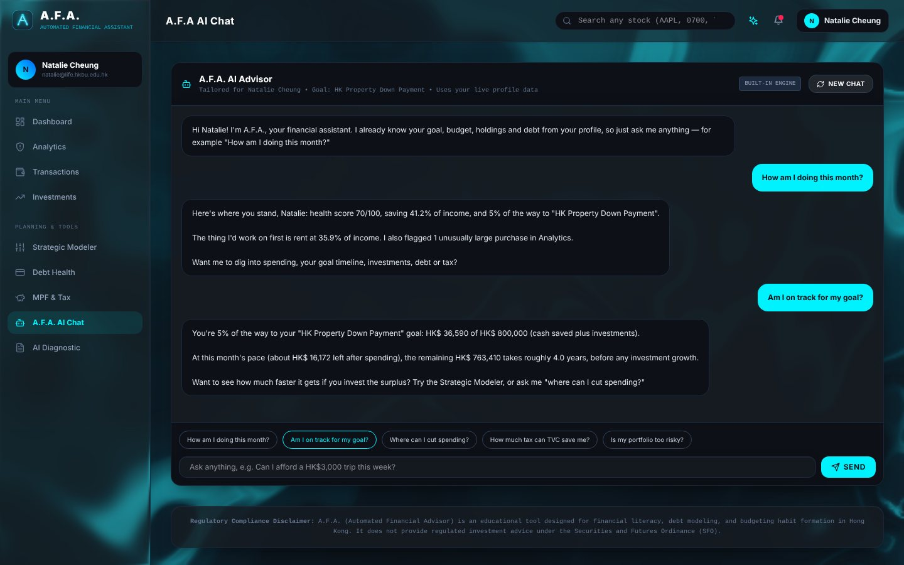
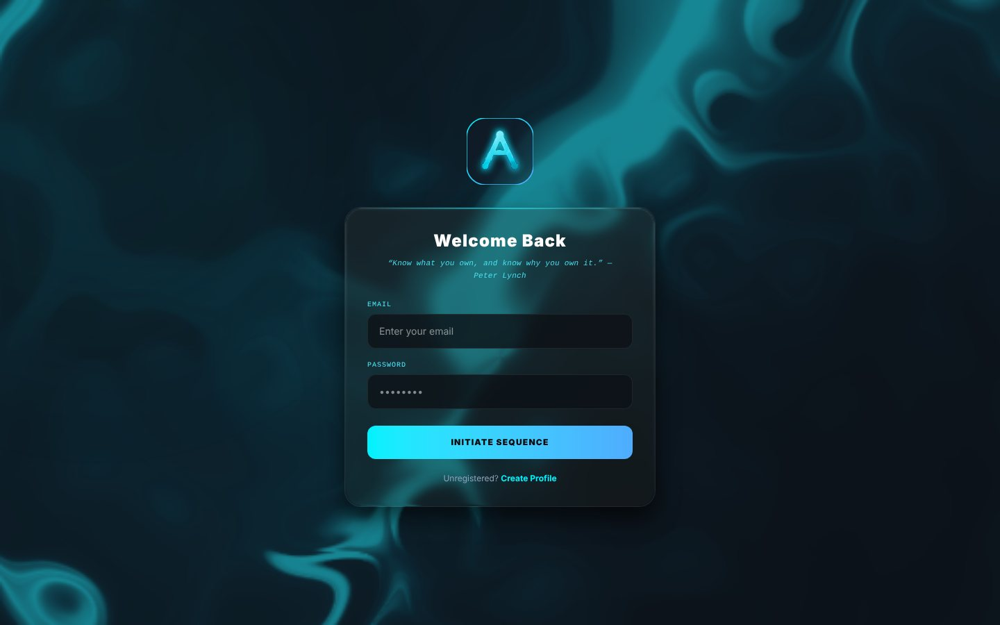
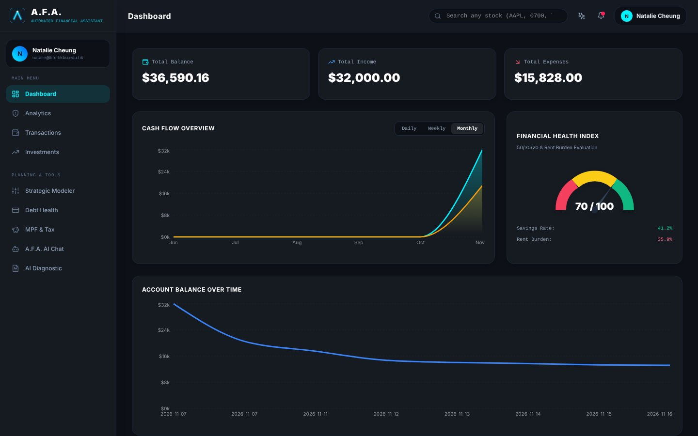
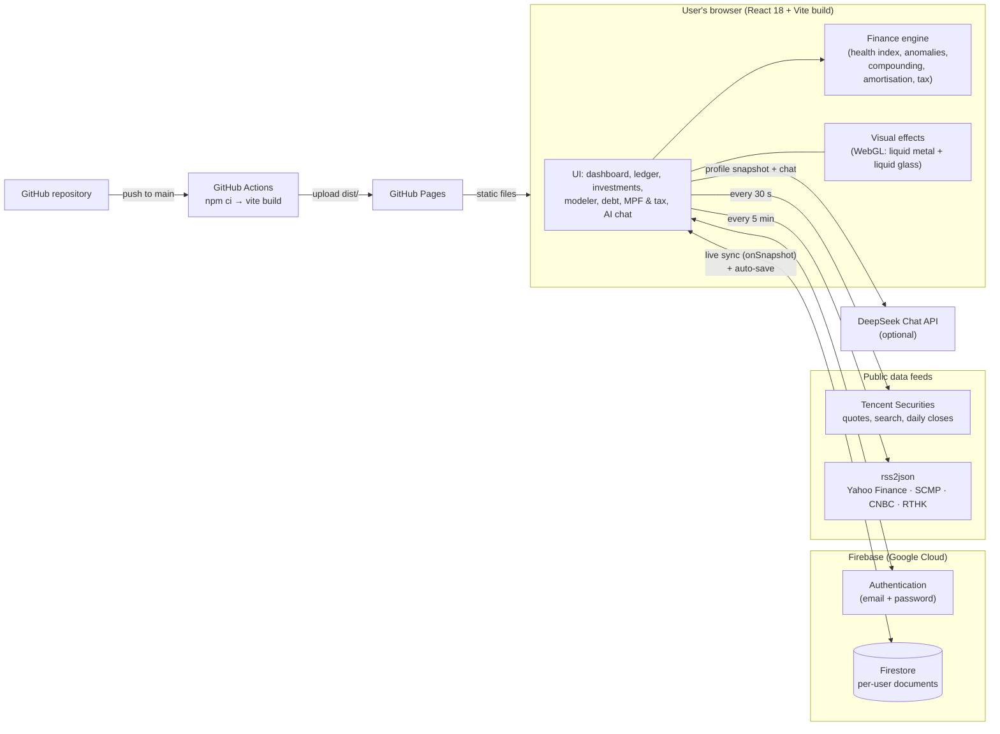
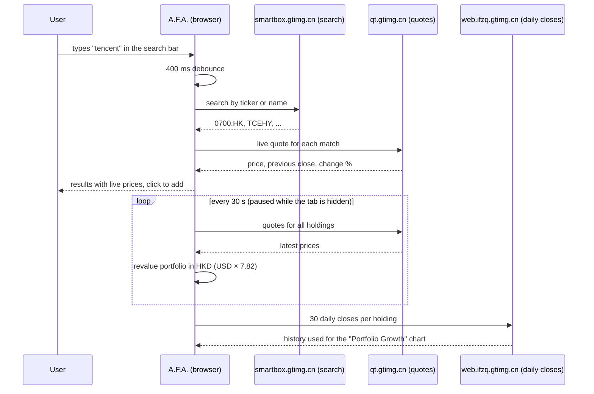
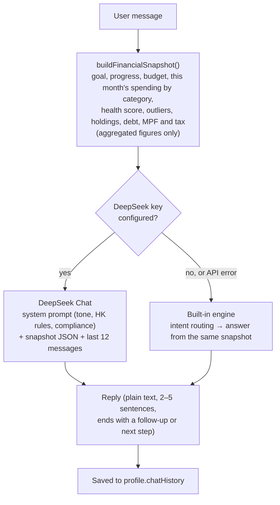
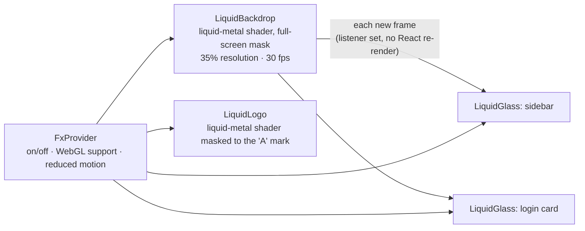
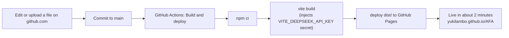

<div align="center">

# A.F.A. — Automated Financial Assistant

**An AI-driven personal finance and wealth-management web app for young adults in Hong Kong**

[**Live site → yukilambo.github.io/AFA**](https://yukilambo.github.io/AFA/)


BBA Capstone Project · Hong Kong Baptist University · Huang Yuk Lam · Supervisor: Dr. Duan Yang



</div>

---

## Contents

1. [Why A.F.A.](#1-why-afa)
2. [Features](#2-features)
3. [Architecture](#3-architecture)
4. [How it works](#4-how-it-works)
5. [Engineering process](#5-engineering-process)
6. [Testing and verification](#6-testing-and-verification)
7. [Build and deployment](#7-build-and-deployment)
8. [Project structure](#8-project-structure)
9. [Running locally](#9-running-locally)
10. [Security, privacy and compliance](#10-security-privacy-and-compliance)
11. [Limitations and future work](#11-limitations-and-future-work)
12. [Credits](#12-credits)

---

## 1. Why A.F.A.

Young adults in Hong Kong know the theory of money but struggle with the habits. The Investor and Financial Education Council (IFEC, 2024) found that **81%** of young adults show high basic financial knowledge, yet only **16%** of young working adults keep a regular budget, and 23–25% fail to pay their full credit-card balance at least once a year. They also face one of the world's most expensive housing markets, fast-growing digital credit (virtual-bank loans, buy-now-pay-later), and an MPF system many find confusing.

Existing tools are fragmented and rarely reflect Hong Kong's tax rules, MPF or living costs. A.F.A. combines the key tools in one place and turns abstract concepts into **real-time, personalised nudges**, the kind of intervention the IFEC and OECD research recommends over static reading material.

**Objectives**

- Improve budgeting adherence, emergency saving, responsible credit use and MPF engagement.
- Give personalised guidance grounded in Hong Kong rules (MPF, TVC, salaries tax).
- Stay **education-first**: general guidance with clear disclosures, not regulated investment advice.

---

## 2. Features

| Module | What the user sees | Underlying concept |
|---|---|---|
| **Financial Health Index** | A 0–100 score with savings rate and rent burden | 50/30/20 budgeting (Warren & Tyagi, 2005); rent-burden affordability (Quigley & Raphael, 2004) |
| **Dual Ledger + Analytics** | Income/expense ledger, cash-flow charts, flagged outliers, weekend-spending ratio | Statistical anomaly detection (Gathergood, 2012); weekend impulse spending (Vohs & Faber, 2007) |
| **Quick recorder** | Bottom-sheet recorder: 38 icon categories, a built-in keypad with + / − on phones (no phone keyboard needed) and a normal amount field with Enter-to-save on computers, account, date and note chips, and "Save & next" for logging several records in a row | Low-friction expense tracking increases logging consistency |
| **Repeating transactions** | Any record can repeat daily, weekly, every 2 weeks, monthly or yearly, with an optional end date; A.F.A. records each due date automatically and the user can pause or stop it | Automation of recurring cash flows (salary, rent, transport) |
| **Personal Action Plan** | Analytics scores five areas (spending, safety net, debt, investing, goal) and ranks up to 20 concrete recommendations with HK$ amounts, step-by-step actions and a button to the right page; tailored by age, risk profile, goal, income and dependants | 50/30/20 rule; emergency-fund sizing; debt avalanche; age- and risk-based allocation; HK TVC tax rules |
| **Budget alerts** | Warnings when weekly spending passes the user's limit, and a confirmation when the savings target is met | Real-time nudges (Lukas et al., 2023) |
| **Investments** | Holdings with **live HK and US prices** (auto-refresh every 30 s), a 30-day value history from real closing prices, and allocation | Mark-to-market valuation; diversification |
| **Simulated trading** | Paper-trading account with HK$100k–1M of virtual cash: search any HK/US stock, ETF, warrant or CBBC (by name or code), buy and sell at live prices with a 0.1% simulated fee, and track equity, realised and unrealised P&L and trade history, separate from real holdings | Learning by practice without financial risk |
| **Stock analysis & valuation** | For any HK/US stock: last session, volume vs averages, 52-week range, 1M/3M/1Y returns, volatility, Sharpe and max drawdown; five technical indicators (MA alignment, KD, RSI, MACD, Bollinger) combined into a −10…+10 score; a candlestick chart with MA5–MA240, Bollinger bands, volume and a 20-day Holt projection; and a valuation calculator (P/E multiple, 5-year earnings DCF, dividend discount, Graham) with margin of safety. Company news is pulled per stock (Google News RSS) and scored for sentiment. A saved **watchlist** gives one-click access with live prices. A **trade plan** turns this into Buy / Accumulate / Hold / Reduce / Sell with an entry zone, a profit-maximising take-profit, a stop-loss, reward-to-risk, the chance of hitting the target first, and valuation buy-below / sell-above prices, drawn on the chart. One click hands the stock to Simulated Trading. Live market news has its own tab | Technical analysis (Murphy, 1999); DCF and dividend-discount valuation (Damodaran, 2012); Graham (1962) |
| **Other assets & net worth** | Bonds (coupon, maturity), crypto with live CoinGecko prices, HK warrants and CBBCs (code, call/put or bull/bear, underlying, strike, call level, entitlement ratio, expiry; live prices, gearing and expiry / call-level warnings), deposits, funds, gold, property, insurance cash value and MPF; a total net worth (cash + stocks + other assets − debts) and allocation bar | Whole-balance-sheet view of household wealth |
| **Live stock search** | Search **any** HK or US stock by ticker or company name (`700`, `AAPL`, `tencent`) and add it in one click | — |
| **Live news** | Headlines from Yahoo Finance, SCMP, CNBC and RTHK, refreshed every 5 minutes; stories about the user's holdings are tagged | — |
| **Strategic Wealth Modeler** | Projects wealth from starting capital, monthly deposit, return and horizon | Time value of money, monthly compounding (Bodie, Kane & Marcus, 2014) |
| **Debt Health** | Users record and save every debt they owe (name, type, balance, APR, minimum payment), then get a multi-debt payoff plan with debt-free date, total interest and payoff order | Avalanche vs Snowball amortisation (Lusardi & Mitchell, 2014) |
| **MPF & Tax** | Mandatory MPF and the salaries tax saved by Tax-Deductible Voluntary Contributions (TVC) | HK progressive salaries tax and MPF rules |
| **A.F.A. AI Chat** | A conversational assistant that already knows the user's profile, budget, holdings and debt, and remembers the conversation | LLM with a structured financial snapshot, plus a built-in fallback engine |
| **Saved profile** | Everything a user enters (profile, ledger, holdings, calculator inputs, chat) is restored at next login | Per-user Firestore documents |
| **Liquid visual effects** | Liquid-metal logo and a liquid-glass interface over an animated background, with an on/off switch | WebGL shaders adapted from two MIT-licensed projects |

<table>
<tr>
<td width="50%"><br><sub><b>Live market search</b>: any ticker or company name, with the live price.</sub></td>
<td width="50%"><br><sub><b>AI chat</b>: answers use the user's own figures and follow on from earlier questions.</sub></td>
</tr>
<tr>
<td width="50%"><br><sub><b>Login</b>: the original logo animation, which then turns into liquid metal behind a liquid-glass card.</sub></td>
<td width="50%"><br><sub><b>Effects off</b>: the original design, used automatically when WebGL is unavailable.</sub></td>
</tr>
</table>

<sub>Screenshots show a demo account with sample data, captured in the automated browser test harness described in section 6.</sub>

---

## 3. Architecture

A.F.A. is a **single-page React application** served as static files from GitHub Pages. It has no custom server: Firebase provides authentication and the database, and the browser calls public market, news and AI APIs directly.



**Technology stack**

| Layer | Choice | Why |
|---|---|---|
| UI | React 18, Tailwind CSS, lucide-react icons | Component model; rapid, consistent styling |
| Charts | Recharts | Declarative charts that fit React |
| Build | Vite 5 | Fast builds; env-variable injection at build time |
| Auth and data | Firebase Authentication + Cloud Firestore | Managed, real-time sync, security rules, no server to run |
| Market data | Tencent Securities public quote endpoints | Browser-accessible (CORS-enabled), covers HK and US, no key |
| News | rss2json over four finance RSS feeds | Browser-accessible JSON from reputable sources |
| AI | DeepSeek Chat (OpenAI-compatible API) | Low cost; easy to swap for another provider |
| Graphics | WebGL 1 fragment shaders | GPU-rendered effects with no extra libraries |
| Hosting and CI/CD | GitHub Pages + GitHub Actions | Free, automatic deploy on every push |

---

## 4. How it works

### 4.1 Data model and persistence

Each user's data lives under their Firebase Auth user ID. The app subscribes with `onSnapshot`, so changes appear instantly and survive logging out.

```
artifacts/afa-default/users/{uid}/
├── profile/data          name, goal, target amount, risk profile, monthly income,
│                         weekly spend limit and savings target, debt inputs,
│                         settings { modeler, MPF and TVC inputs, chart view },
│                         chatHistory [ last 30 messages ]
├── transactions/{id}     date, description, category, amount, type, account
└── portfolio/{id}        symbol, name, shares, buy price, last price, currency, category
```

- **Onboarding** saves the full profile at registration, so nothing has to be re-entered.
- **Calculator inputs** (modeler, debt, MPF and TVC) auto-save 1.2 s after the user stops typing (debounced) and are restored once per login.
- **Debts** are stored on the profile as a `debts` array, with a Save button and a saved/unsaved status. Older profiles that held a single total are converted into one debt on first load.
- **Chat history** is saved after every reply and restored at login. "New Chat" clears it.
- **Latest prices** are written back to each holding, so the next login opens with recent values even before the live feed answers.
- **Security rules** ([`firestore.rules`](firestore.rules)) let a signed-in user read and write only their own subtree. Unauthenticated requests are rejected.

### 4.2 Live market data



- **Ticker normalisation:** `700`, `0700`, `0700.hk` → `0700.HK`, and `aapl` → `AAPL`. Each maps to the feed's codes (`r_hk00700`, `usAAPL`).
- **Text encoding:** the quote feed returns GBK-encoded text, decoded with `TextDecoder('gbk')`.
- **Fallback:** if the primary feed fails, a Yahoo Finance request through a public proxy is tried.
- **No invented data:** if every source fails, the app keeps the last saved prices and says *"Live price feed unreachable"*. The earlier version silently showed hard-coded prices and random chart values. Both were removed.

### 4.3 Live news

Four RSS feeds (Yahoo Finance, SCMP Business, CNBC Markets, RTHK Finance) are fetched in parallel through rss2json. When the user holds stocks, a fifth feed of Yahoo headlines for those tickers is added. Results are de-duplicated, sorted by publish time, and tagged when a headline mentions a holding's ticker or company name. The feed refreshes every 5 minutes and whenever holdings change.

### 4.4 Finance engine

All calculations run in the browser on the user's own data, recomputed with React `useMemo` whenever the data changes.

| Calculation | Implementation |
|---|---|
| **Savings rate** | (income − expenses − investment deposits) ÷ income |
| **Rent burden** | rent ÷ income |
| **Health Index** | Starts at 50; +20 if savings rate ≥ 20% (+10 if ≥ 10%); +20 if rent burden is between 0% and 35%; +10 if investment rate ≥ 15%; capped at 0–100 |
| **Outlier detection** | Mean μ and standard deviation σ of all expenses; flags expenses above max(μ + 1.8σ, HK$1,500) |
| **Weekend ratio** | Saturday and Sunday spending ÷ total spending (alert above 50% and HK$1,000) |
| **Wealth projection** | Monthly compounding: *B*ₜ₊₁ = (*B*ₜ + deposit) × (1 + *r*/12), tracked against total contributed |
| **Debt payoff** | Month by month for every debt: add interest (balance × APR/12), pay each minimum, then send the extra payment plus any freed-up minimums to the target debt (Avalanche: highest APR first; Snowball: smallest balance first). Flags plans whose payments never beat the interest |
| **Repeating transactions** | Each rule stores its next date; at login every due date up to today is written as a normal transaction with the id `ruleId_date` (so it can never be recorded twice). Monthly and yearly rules keep their original day, using the last day of shorter months |
| **Monthly averages (Action Plan)** | Last 90 days. A category that occurs about once a month (rent, salary) is averaged over the calendar months it appears in; everyday spending is averaged over the actual time span |
| **Emergency fund** | Liquid cash (bank, cash, Octopus, deposits) ÷ monthly essential spending; target 3 months, 6 with dependants or mainly freelance income |
| **Target allocation** | Growth share (stocks, funds, crypto) of 35% / 60% / 80% for conservative / moderate / aggressive, minus 10 points at 50 and again at 60; flagged when off by more than 15 points. Crypto cap 2% / 5% / 10% |
| **Warrant / CBBC metrics** | Intrinsic value per unit = max(0, S − K) ÷ ratio (calls, bulls) or max(0, K − S) ÷ ratio (puts, bears); effective gearing ≈ S ÷ (W × ratio); CBBC distance to call = (S − call) ÷ S. The plan flags expiry within 30 days, a CBBC within 5% of its call level, or leveraged products above 2% / 5% / 10% of investments by risk profile |
| **Technical indicators** | SMA; EMA seeded with SMA; RSI-14 with Wilder smoothing; KD 9,3,3 (RSV over 9 days, K and D smoothed by 1/3); MACD 12,26,9; Bollinger 20 days ± 2σ. Each scores −2…+2; total ≥ 5 strong bullish, ≥ 2 bullish, ≤ −2 bearish, ≤ −5 strong bearish |
| **Risk statistics** | Annualised volatility = σ(daily log returns) × √252; Sharpe = (annualised 1-year return − 3%) ÷ volatility; max drawdown over the last 252 days |
| **Price projection** | Holt linear exponential smoothing; α, β chosen by grid search on one-step-ahead squared error; 95% range = ±1.96σ√h. Shown as an extension of the trend, not a prediction |
| **Valuation** | P/E: EPS × fair P/E. DCF: Σ EPS(1+g)ᵗ/(1+r)ᵗ for 5 years + EPS₅ × exit P/E/(1+r)⁵. DDM: DPS(1+g)/(r−g). Graham: EPS × (8.5 + 2g). Fair value = median of the models; margin of safety = (fair − price) ÷ fair |
| **News sentiment** | Each headline is scored (positive − negative words) ÷ (all matched words) with a finance word list in the spirit of Loughran & McDonald (2011); severe events (fraud, trading halt, profit warning, delisting…) count double and are flagged. Headlines are averaged with a 3-day half-life; at least 2 headlines are needed for news to count |
| **Trade plan** | Signal from 0.35 × technical score/10 + 0.35 × valuation gap (÷30%, capped) + 0.15 × 3-month momentum (÷15%, capped) + 0.15 × news sentiment, re-weighted when a part is missing; a severe news event in the last 14 days caps the signal at Hold: ≥ 0.35 Buy, ≥ 0.12 Accumulate, > −0.12 Hold, > −0.35 Reduce, else Sell. Entry zone: nearest support (swing lows, MA20/60, lower band) to price; stop = below support and ≥ 1.5 ATR. Take-profit T maximises E(T) = P(hit T) × (T − entry) − P(hit stop) × (entry − stop) + P(neither) × (expected end − entry) over 60 days, with barrier-hitting probabilities for a drifting random walk using the stock's own volatility; drift = ½ Holt trend + 30% of the valuation gap per year (capped). Valuation prices: buy below 0.8 × fair, sell above 1.2 × fair |
| **Simulated trade** | Buy: cash −= shares × price × FX × 1.001; average cost re-weighted. Sell: realised P&L = (price − avg cost) × shares × FX − fee |
| **Mandatory MPF** | 5% of income between HK$7,100 and HK$30,000 (HK$1,500 maximum) |
| **TVC tax saving** | Salaries tax without TVC minus salaries tax with TVC (deduction capped at HK$60,000; mandatory MPF deduction capped at HK$18,000) |
| **Salaries tax** | The lower of: progressive (2 / 6 / 10 / 14% on successive HK$50,000 bands, then 17%, after the HK$132,000 basic allowance) or the standard rate (15% on the first HK$5M of net income, 16% above) |

> The TVC estimate previously used a flat 15% rate, which overstated the saving for most young earners on the lower bands. It now uses the progressive calculation.

### 4.5 AI assistant



- **Personalised by design:** every message is answered from a fresh snapshot of the user's live data, so the assistant never asks for information the app already has.
- **Conversation memory:** the last 12 messages are sent to the model, and the whole chat is restored at next login.
- **Built-in engine:** without an API key, or if the API fails, a rule-based engine recognises intents (overview, goal, affordability, spending, tax, debt, investing, rent, greetings). It handles short follow-ups like "tell me more" by continuing the previous topic with new detail, for example the time saved on the goal by cutting a spending category.
- **Guardrails:** the system prompt requires the user's real figures (*"never invent figures"*), forbids buy or sell recommendations for specific securities, states Hong Kong MPF and tax facts, and keeps an education-only stance.
- **Data minimisation:** the snapshot contains aggregated figures. Email, transaction descriptions and contacts are not sent.

### 4.6 Visual effects (liquid metal and liquid glass)

Adapted from [liquid-logo](https://github.com/collidingScopes/liquid-logo) and [liquid-glass-js](https://github.com/dashersw/liquid-glass-js), both MIT-licensed (see [THIRD_PARTY_NOTICES.md](THIRD_PARTY_NOTICES.md)).



- **Liquid metal:** the liquid-logo shader detects the edges of the "A" mark and flows a noise-driven vector field around them. I added a **duotone colour map** (dark navy → cyan → white) to match the brand, anti-aliased edges and 2× supersampling for small sizes. On the login screen the original stroke-drawing animation plays first, then the metal fades in. **The opening splash animation is unchanged.**
- **Liquid glass:** liquid-glass-js refracts a one-time `html2canvas` screenshot of the page, which goes stale in a live dashboard. The adapted version instead refracts the **live animated backdrop canvas every frame**, keeping the library's rim and edge refraction model, Gaussian blur and tint. The blur kernel was reduced (13×13 → 7×7) and the canvas renders at half resolution so it can run continuously.
- **Glass blocks:** every dashboard block is liquid glass. Rather than one WebGL context per block (browsers allow only about 16), `LiquidGlassLayer` draws all visible blocks in a single full-screen pass: each pixel finds the block it belongs to and applies the same refraction model. It redraws on each backdrop frame and immediately on scroll, so the glass stays aligned with the cards.
- **Performance:** at most 4 WebGL contexts per screen. Rendering pauses when the tab is hidden and the logo pauses when off-screen. Contexts are released on unmount, since browsers allow only about 16.
- **Accessibility and fallback:** effects are off by default when the system asks for reduced motion, can be toggled with the ✦ button in the header (remembered per device), and switch off automatically if WebGL or shader compilation fails. In every case the UI falls back to the original design.

---

## 5. Engineering process

The project followed an iterative **audit → design → implement → verify** loop.

**1. Proposal to MVP.** The capstone proposal defined five modules (Health Index, Dual Ledger, Debt Optimizer, Wealth Simulator, MPF & Tax) plus a conversational assistant. The first build implemented them in React with Firebase and deployed to GitHub Pages.

**2. Audit of the live deployment.** The deployed site was tested from its real origin (`yukilambo.github.io`) to see what actually worked, rather than what the code intended:

| Finding | Evidence | Fix |
|---|---|---|
| Stock prices were not live | The CORS proxy timed out (HTTP 408), so the app silently showed six hard-coded prices | Switched to a CORS-enabled quote feed, verified from the deployed origin; auto-refresh every 30 s; removed hard-coded prices |
| News was not live | Same proxy; three fixed fallback headlines were shown instead | Direct rss2json requests to four feeds, plus holding-specific headlines |
| Search could not find new stocks | It only searched the user's existing holdings | Market-wide search by ticker or company name, with live prices |
| Chatbot never reached the AI | The key file was named `import.meta.env`, so Vite never loaded it | Key supplied as a GitHub Actions secret at build time; built-in engine as a fallback |
| Chatbot answers were generic | Long template responses with no conversational context | Profile snapshot, conversation memory, short follow-up style replies |
| Inputs were lost on logout | Calculator inputs and chat lived only in memory | Debounced auto-save to Firestore, restored at login |
| Portfolio chart was invented | Built with `Math.random()` | Rebuilt from real daily closing prices |
| TVC saving was overstated | Flat 15% tax rate | Progressive HK salaries-tax calculation |
| Deployment was manual and fragile | Built files and 20,000+ `node_modules` files committed; an API key committed in plain text | GitHub Actions build-and-deploy, `.gitignore` for secrets and build output |

**3. Design iteration.** A full redesign in a "Bloomberg terminal" style was prototyped. After review, the original interface was preferred, so the project kept the existing UI and focused on correctness, data and persistence. Later, the liquid-metal and liquid-glass effects were added as an **optional layer** on top of that design, rather than replacing it.

**4. Verification.** Every change was checked in an automated browser harness (section 6) before release.

---

## 6. Testing and verification

| Check | Method | Result |
|---|---|---|
| Data feeds reachable from the deployed site | Requests run from `yukilambo.github.io` in a real browser | Tencent quotes, search and history, and rss2json: reachable; the old proxy: timing out |
| Ticker coverage | Quotes for HK (`700`, `2800.HK`, `9988.hk`) and US (`AAPL`, `TSLA`, `VOO`, `QQQ`, `BRK.B`, `NVDA`); invalid tickers return nothing | All resolved; invalid tickers show "not found" |
| End-to-end flows | Playwright (headless Chromium) with Firebase stubbed and feeds mocked: live prices, today's change, news tagging, search → add asset, chat replies, chat persistence, settings restored after reload | All checks passed with no console errors |
| AI request path | Mocked DeepSeek endpoint: confirms the `Authorization` header, model, system prompt with snapshot, and message roles | Correct request shape; reply displayed |
| Visual effects | WebGL rendering (SwiftShader) of the login and dashboard; toggle on/off; survives reload; reduced-motion default | Renders, toggles and falls back as designed |
| Finance formulas | Hand-checked examples, e.g. HK$32,000/month with HK$24,000 TVC saves about HK$4,080 tax | Matches the progressive-tax calculation |

The test harness is not yet committed as an automated suite; adding it to CI is listed under future work.

---

## 7. Build and deployment



- Workflow: [`.github/workflows/deploy.yml`](.github/workflows/deploy.yml). It runs on every push to `main`, or manually from the Actions tab.
- **AI key (optional):** add a repository secret named `VITE_DEEPSEEK_API_KEY` under *Settings → Secrets and variables → Actions*. Without it, the chatbot uses its built-in engine.
- **GitHub Pages:** *Settings → Pages → Build and deployment → Source: GitHub Actions*.

---

## 8. Project structure

```
├── .github/workflows/deploy.yml   CI/CD: build and deploy to GitHub Pages
├── index.html                     HTML entry (title, favicon links)
├── public/                        Favicon and app icons (the A.F.A. "A")
├── vite.config.js                 Vite config (base path /AFA/)
├── firestore.rules                Recommended per-user security rules
├── THIRD_PARTY_NOTICES.md         Licences for adapted shader code
├── docs/screenshots/              README images
└── src/
    ├── main.jsx                   React entry, wraps the app in <FxProvider>
    ├── App.jsx                    Application: UI, finance engine, data sync, live feeds, AI chat
    ├── components/
    │   ├── TransactionComposer.jsx  Quick recorder: categories, keypad, repeat options
    │   ├── PaperTrading.jsx         Simulated trading account
    │   ├── StockAnalysis.jsx        Indicators, chart, projection and valuation calculator
    │   └── OtherAssets.jsx          Bonds, crypto, deposits, property... with live crypto prices
    ├── lib/
    │   ├── indicators.js            Technical indicators, risk statistics, Holt forecast, valuation models
    │   └── insights.js              Scores and ranked recommendations (pure functions)
    ├── firebase.js                Firebase initialisation (Auth + Firestore)
    └── effects/
        ├── FxContext.jsx          Effects on/off state, WebGL and reduced-motion detection
        ├── LiquidBackdrop.jsx     Animated liquid-metal background
        ├── LiquidLogo.jsx         Liquid-metal "A" logo
        ├── LiquidGlass.jsx        Glass refraction for the sidebar and login card
        ├── LiquidGlassLayer.jsx   Glass for every dashboard block in one WebGL pass
        ├── shaders.js             GLSL shaders (adapted, with attribution)
        └── gl.js                  WebGL helpers and colour presets
```

---

## 9. Running locally

```bash
git clone https://github.com/YukiLambo/AFA.git
cd AFA
npm install
cp .env.example .env          # optional: add VITE_DEEPSEEK_API_KEY for the AI chat
npm run dev                   # http://localhost:5173/AFA/
npm run build                 # production build in dist/
```

---

## 10. Security, privacy and compliance

- **Access control:** Firestore rules restrict each user to their own documents (verified: unauthenticated reads return `PERMISSION_DENIED`).
- **Secrets:** `.env` files are git-ignored and the AI key is supplied as a GitHub Actions secret. Because GitHub Pages serves static files, any key used by the browser is visible in the published JavaScript, so it should have a low spending limit. A server-side proxy is the long-term fix (section 11).
- **Data minimisation (PDPO):** only the data needed for the features is stored, and the AI receives aggregated figures only.
- **Regulatory posture (SFC):** A.F.A. is an educational tool. It provides general guidance and explicitly does not give regulated investment advice or recommend specific securities.

---

## 11. Limitations and future work

| Limitation | Planned improvement |
|---|---|
| The AI key is exposed in the static bundle | Move AI calls to a serverless function (e.g. Firebase Cloud Functions) so the key stays server-side |
| Market data uses public endpoints without a service-level agreement | Use a licensed market-data API for production |
| USD/HKD uses a fixed 7.82 rate | Fetch the live rate (HKD is pegged within 7.75–7.85, so the error is small) |
| `App.jsx` is about 3,500 lines | Split into feature modules and custom hooks, and add unit tests for the finance engine |
| No automated test suite in CI | Commit the Playwright harness and run it in GitHub Actions |
| Tailwind is loaded from a CDN at runtime | Compile Tailwind at build time for faster loads |
| No pilot data yet | Run the pilot with tertiary institutions and measure literacy and behaviour outcomes (proposal, section 9) |

---

## 12. Credits

- **Liquid-metal shader:** [liquid-logo](https://github.com/collidingScopes/liquid-logo) by Alan Ang. MIT License.
- **Liquid-glass refraction shader:** [liquid-glass-js](https://github.com/dashersw/liquid-glass-js) by Armagan Amcalar. MIT License.
- **Data:** Tencent Securities (quotes); Yahoo Finance, South China Morning Post, CNBC and RTHK (news, via rss2json).
- **References:** IFEC (2020, 2022, 2024) *Financial Literacy Monitor*; OECD (2020) *PISA 2018 Results, Vol. IV*; Warren & Tyagi (2005); Quigley & Raphael (2004); Gathergood (2012); Vohs & Faber (2007); Lukas et al. (2023); Bodie, Kane & Marcus (2014); Lusardi & Mitchell (2014). Full list in the capstone proposal.

<sub>A.F.A. is an educational project and does not provide investment, tax or legal advice.</sub>
